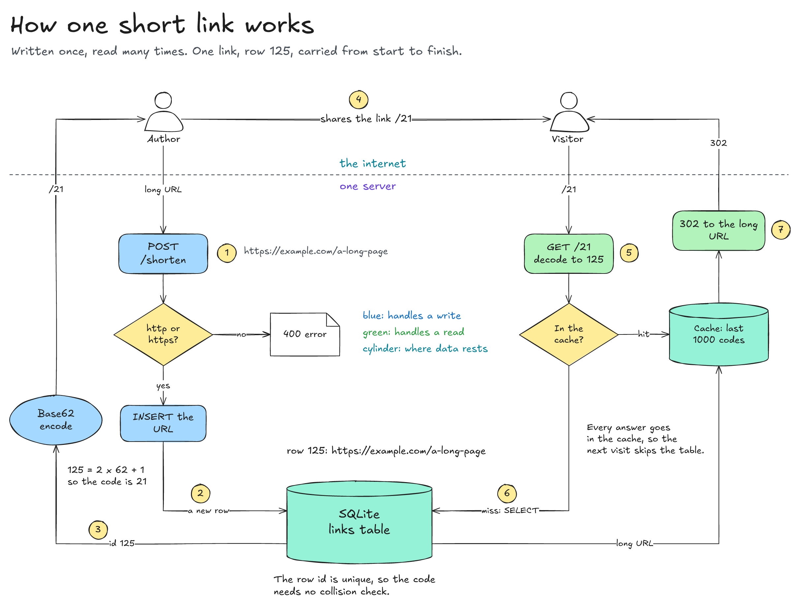

# system-diagram

An agent skill that explains a real codebase with one continuous, hand-drawn Excalidraw diagram, then tests whether you can defend it.



This picture is the worked example in [`examples/url-shortener`](examples/url-shortener). The system in it is made up, small and runnable, so every ledger citation resolves.

## What it produces

- **An evidence ledger.** One row for each claim on the diagram, with a `path:line` citation. A claim with no evidence is marked `assumed`.
- **One `.excalidraw` diagram.** A single connected drawing you can trace from the first actor to the last output. It opens in real Excalidraw, and arrows stay attached when you move a box.
- **A study guide.** One HTML file that starts from the problem and builds up to exact mechanics.
- **Likely questions, with answers.** Predicted by walking each box and arrow through lenses such as failure, state, trust and numbers.
- **An optional grill.** The agent questions you in rounds and grades your answers against the ledger.

It can also coach: you draw, and the agent feeds you the next piece and critiques your board.

## Quick start

1. Install it as a Claude Code skill:

   ```bash
   git clone https://github.com/PieLord757/system-diagram-skill.git
   ```

   ```bash
   mkdir -p ~/.claude/skills && cp -R system-diagram-skill/skills/system-diagram ~/.claude/skills/
   ```

2. Open Claude Code in the project you want explained, and ask:

   > Draw the system design of our checkout flow on Excalidraw and grill me on it.

   To draw it yourself with coaching, ask: "Help me draw how our checkout flow works. I'll hold the pen."

3. Drag the finished `.excalidraw` file onto [excalidraw.com](https://excalidraw.com) to open and edit it.

## What happens when you run it

1. The agent reads the code and writes the ledger.
2. It writes a spoken walk of about 150 words around one concrete example and shows it to you.
3. It draws one stretch at a time, rendering each and fixing what it sees.
4. `check_scene.py` must report 0 errors: arrows attached, text legible, no card-style boards, every citation found.
5. It writes the study guide and the likely questions.
6. It hands everything over, says what it could not establish, and offers the grill.

Files for a diagram go in `docs/architecture/` in your project.

## Requirements

- Python 3, for building and checking diagrams. Standard library only.
- Node with `npx`, for rendering to PNG. The first render downloads `mcp-excalidraw-server@2.1.2`.
- `uv`, only for `scripts/share.py`, which makes an excalidraw.com link when you ask for one. It encrypts the scene locally and uploads the ciphertext to excalidraw.com, and anyone with the link can open it.

## Try the example

```bash
cd examples/url-shortener && python3 build.py
```

```bash
python3 ../../skills/system-diagram/scripts/check_scene.py url-shortener.excalidraw --ledger url-shortener.ledger.md --root .
```

```bash
python3 ../../skills/system-diagram/scripts/render.py url-shortener.excalidraw out.png
```

Run the tests from the repository root (needs Node and Python 3):

```bash
node --test test/system-diagram-skill.test.mjs
```

## Limits

- The checker confirms that a cited file and line exist. It does not confirm that the line supports the claim. The skill asks a fresh subagent to check the guide, and that is only as good as the agent.
- Text sizes are estimated, because Excalifont metrics are not available from Python. Look at the render as well as the checker result.
- The checker enforces one house style: at most 560 words, nothing under 22 point, no frames, no walls of same-size cards. A very large system needs a narrower subject or several diagrams.
- Diagrams are built from Python coordinates, so layout is planned by the agent rather than solved automatically. Expect a few render-and-fix passes.
- The skill is written for Claude Code. Other agents that read `SKILL.md` folders may work, but that has not been tested.

## Credits

- The grill adapts the method of the MIT-licensed [`grilling` skill](https://github.com/mattpocock/skills) by Matt Pocock. See [NOTICE.md](NOTICE.md).
- The visual-argument ideas were informed by [`coleam00/excalidraw-diagram-skill`](https://github.com/coleam00/excalidraw-diagram-skill). That repository has no license, so only ideas were used and none of its text.
- Rendering uses [`mcp-excalidraw-server`](https://www.npmjs.com/package/mcp-excalidraw-server) (MIT) through a pinned `npx` call. It is not vendored here.

## License

MIT. See [LICENSE](LICENSE).
